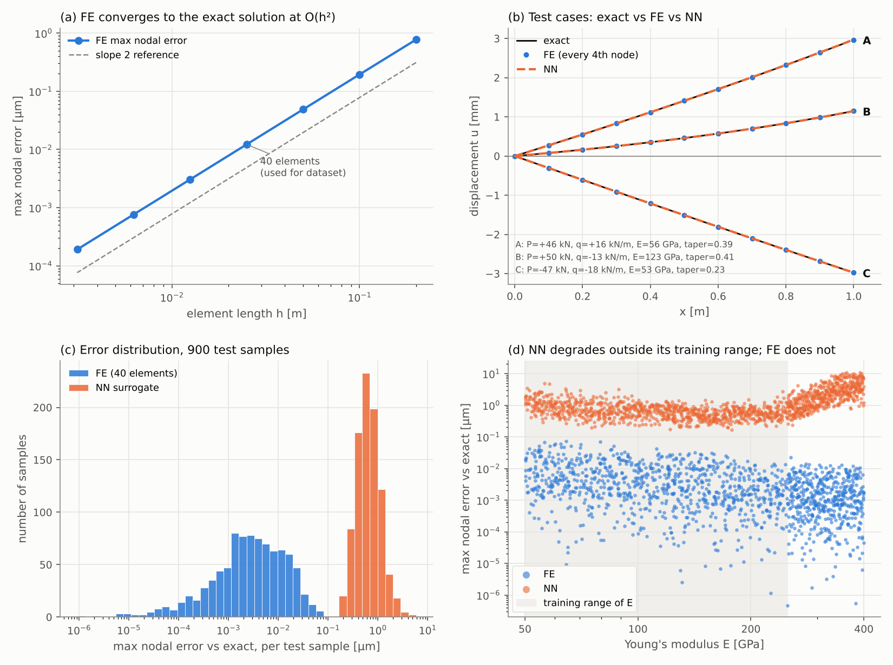

# 1D bar: finite elements vs a neural-network surrogate

A small, end-to-end comparison of a classical finite element (FE) solver and a
neural network trained to imitate it, on a problem with a known exact answer.

1. **FE solver**: linear bar elements, global stiffness assembly, boundary conditions,
   sparse solve. Verified against the closed-form solution.
2. **Dataset**: 6,000 FE runs over a range of loads and stiffness values.
3. **Surrogate**: a small PyTorch MLP that maps the load and stiffness parameters
   straight to the displacement field.
4. **Comparison**: both are scored against the exact solution.



## The problem

A bar of length L = 1 m is fixed at x = 0. It carries an axial tip force P and a
uniform axial load q per unit length. The cross-section tapers linearly,
A(x) = A0 (1 − taper · x / L), with A0 = 4 cm² (20 × 20 mm).

```
 d/dx ( E A(x) du/dx ) + q = 0,     u(0) = 0,     E A(L) u'(L) = P
```

Because N(x) = P + q(L − x) follows from statics, the displacement can be
integrated exactly:

```
 u(x) = [ (P + qL) · g1(x) − q · g2(x) ] / (E A0),    c = taper / L
 g1(x) = −ln(1 − c x) / c,     g2(x) = (−ln(1 − c x) − c x) / c²
```

For a prismatic bar this reduces to the textbook u = [P x + q(L x − x²/2)] / (E A0).
`barfe/analytic.py` switches to the Taylor series when c is tiny, to avoid
cancellation error.

## Finite element solver (`barfe/fem.py`)

* Uniform mesh of 2-node linear elements. The element stiffness is
  `(E A / h) [[1, −1], [−1, 1]]`, with A taken at the element midpoint.
* Element matrices are scattered into a sparse global matrix (COO → CSR sums the overlaps).
* Consistent load vector: q h / 2 to each node of every element, plus P at the tip node.
* The fixed support u(0) = 0 is applied by elimination, then the reduced system is solved
  with `scipy.sparse.linalg.spsolve`. The support reaction is recovered from the full K.

**Verification** (`scripts/verify_fe.py`, `tests/test_fem.py`):

| Check | Result |
|---|---|
| Prismatic bar, 40 elements | nodal error 8 × 10⁻¹⁸ m (round-off; linear elements are nodally exact here) |
| Tapered bar, mesh refinement 5 → 320 elements | error falls 4× per halving of h, so convergence is **second-order** (panel a) |
| Support reaction | equals −(P + qL) to machine precision |
| K matrix | symmetric, tridiagonal, rank n − 1 before BCs (one rigid-body mode) |

## Dataset (`scripts/make_dataset.py`)

Latin hypercube sample, 40-element mesh, 41 nodal displacements per run:

| Parameter | Range |
|---|---|
| Tip force P | −50 to +50 kN |
| Distributed load q | −20 to +20 kN/m |
| Young's modulus E | 50 to 250 GPa (log-uniform, aluminium to steel) |
| Taper | 0 to 0.5 |

Tip displacements span about ±3.7 mm. A further 500 samples with E = 250–400 GPa
are kept aside to test extrapolation.

## Surrogate (`barfe/surrogate.py`, `scripts/train.py`)

The surrogate is an MLP: 4 inputs → 3 × 64 SiLU → 40 outputs, with 11,240 parameters.
P and q are scaled to ±1, and E enters as log₁₀E. The outputs are the 40 free-node
displacements, standardised per node. It is trained with Adam and a cosine learning
rate schedule for 3,000 epochs on a 70 / 15 / 15 train / validation / test split, and
the checkpoint with the best validation loss is kept.

## Results (900 held-out test samples)

All errors are nodal displacement errors against the **exact** solution.
RMS displacement over the test set is 522 µm.

| | max error | RMS error | RMS error / RMS displacement | median relative L2 |
|---|---|---|---|---|
| FE, 40 elements | 0.072 µm | 0.0057 µm | 0.001 % | 0.0006 % |
| NN surrogate | 4.9 µm | 0.34 µm | 0.064 % | 0.08 % |
| NN, E outside training range (250–400 GPa) | 11.0 µm | 1.75 µm | 1.1 % | 0.96 % |

| Time per sample | |
|---|---|
| FE solve (assembly + sparse solve) | 0.81 ms |
| NN, one call per sample | 0.09 ms |
| NN, batched over the test set | 0.0007 ms |

**What this shows**

* Inside the training range the network matches the solver to about 0.06 % RMS. Its error
  is still about 60× larger than the FE discretisation error, so the network, not the
  mesh, limits the accuracy. NN-vs-FE and NN-vs-exact errors are almost identical for
  the same reason.
* The network is roughly 500–1,000× faster per sample when batched (timings vary from
  run to run). For a 40-element bar
  this hardly matters, but the same trade-off is what makes surrogates useful when
  each solve takes minutes.
* Outside the training range the error grows about 5× and keeps rising with E
  (panel d). The FE solver has no such limit. The surrogate is only trustworthy
  where it has seen data.
* The network only sees FE outputs, so its accuracy is capped by the solver's. With a
  coarse mesh it would faithfully learn the discretisation error too.

## Run it

```bash
pip install -r requirements.txt
python scripts/verify_fe.py      # FE vs exact, convergence table
python scripts/make_dataset.py   # ~5 s, writes data/dataset.npz
python scripts/train.py          # ~3 min on CPU, writes models/surrogate.pt
python scripts/evaluate.py       # metrics table, results/metrics.json, docs/comparison.png
pytest                           # solver tests
```

The trained model is included in `models/`, so `evaluate.py` runs straight after
`make_dataset.py`. The dataset is deterministic, so regenerating it gives the same
samples. Retraining on different hardware gives slightly different NN numbers.

Tested with Python 3.13, NumPy 2.5, SciPy 1.18, PyTorch 2.14 (CPU) and Matplotlib 3.11.

## Layout

```
barfe/
  problem.py     Bar dataclass (geometry, material, loads)
  analytic.py    closed-form displacement
  fem.py         mesh, element stiffness, assembly, loads, BCs, solve
  surrogate.py   MLP and input/output scaling
scripts/         verify_fe → make_dataset → train → evaluate
tests/           pytest checks on the solver
docs/            README figure
results/         metrics.json, convergence study, train/test split
models/          trained surrogate
```
